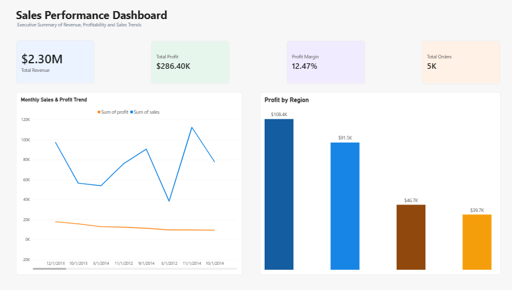
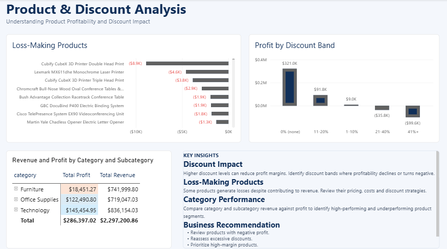
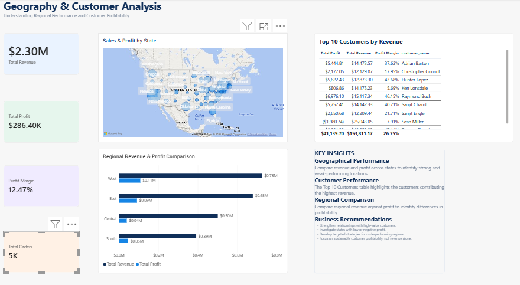

# Retail Sales Intelligence 📊

An end-to-end data pipeline and interactive dashboard for a retail Superstore dataset using **PostgreSQL** and **Power BI**.

## 📌 Project Overview
This project takes a raw, messy CSV file (Windows-1252 encoded) and builds a robust 3-layer SQL pipeline to clean, validate, and analyze over 9,900 retail orders. The cleaned data is then visualized in a 3-page interactive Power BI dashboard designed for executive decision-making.

## 🛠️ Tech Stack
*   **Database:** PostgreSQL
*   **Languages:** SQL, Bash (Terminal)
*   **Visualization:** Power BI
*   **Version Control:** Git / GitHub

## 🗂️ Project Structure
*   `sql/schema.sql`: Creates the raw and clean tables, indexes, and reporting views.
*   `sql/data_cleaning.sql`: Moves data from raw to clean, handling date parsing, numeric casting, and ZIP code restoration.
*   `sql/analysis.sql`: 12 business intelligence queries covering sales, profit, discounts, and customer segments.
*   `data/processed/superstore_clean.csv`: The cleaned dataset exported and ready for use.
*   `powerbi/sales_dashboard.pbix`: The interactive executive dashboard file.
*   `docs/data_dictionary.md`: Full documentation of every column and data type.

## 📸 Dashboard Previews

### Page 1: Executive Summary
*High-level KPIs (Revenue, Profit, Margin) with monthly trend and regional breakdown.*


### Page 2: Product & Discount Analysis
*Identifying loss-making products and the severe impact of aggressive discounting.*


### Page 3: Geography & Customer Analysis
*Mapping profitability by state and identifying top customers (and problem customers).*


## 💡 Key Insights Discovered
*   **Total Revenue:** $2.29M with a 12.47% overall profit margin.
*   **The Discount Problem:** Orders with 41%+ discounts have a massive **-77.4% profit margin**, resulting in over $99,000 in losses.
*   **Geographic Losses:** Texas is a top market by sales ($170K) but loses the most money (-$25.7K) due to an average 37% discount rate.
*   **Loss Leaders:** The "Cubify CubeX 3D Printer" is the single most unprofitable product (-$8,879).
*   **VIP Warning:** Top-spending customer Sean Miller spent $25K but *lost* the company $1.9K due to heavy discounting.

## 🚀 How to Run This Project

1. **Create the Database:**
   ```bash
   psql -U postgres -c "CREATE DATABASE superstore_db;"
2. Build the Schema:

psql -U postgres -d superstore_db -f sql/schema.sql
3. Load the Raw Data :

psql -U postgres -d superstore_db -c "\copy raw_superstore FROM 'data/raw/Superstore.csv' WITH (FORMAT csv, HEADER true, ENCODING 'WIN1252')"
4. Clean and Transform the Data:

psql -U postgres -d superstore_db -f sql/data_cleaning.sql
5. Run the Business Analysis:

psql -U postgres -d superstore_db -f sql/analysis.sql


📄 License
This project is open-source and available under the MIT License.
